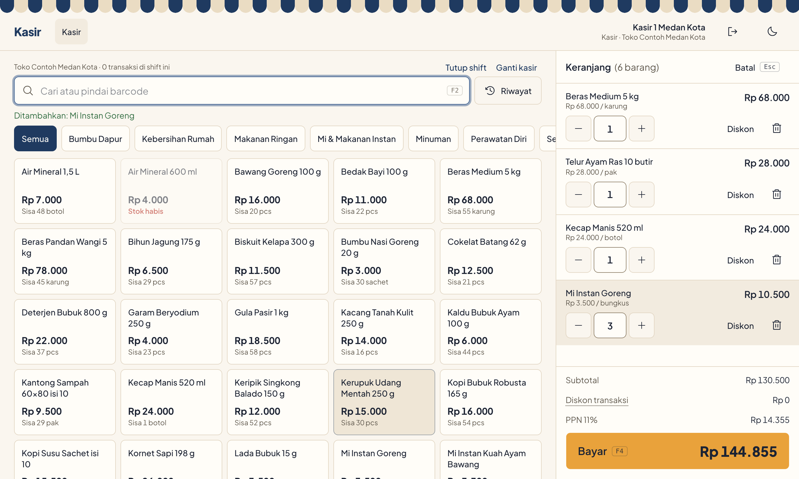
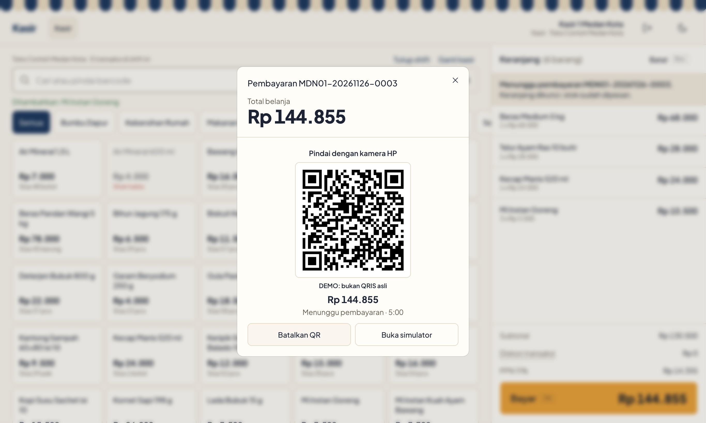
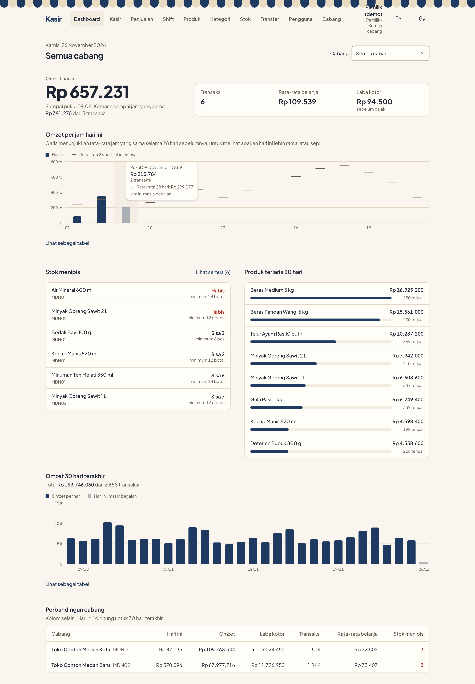
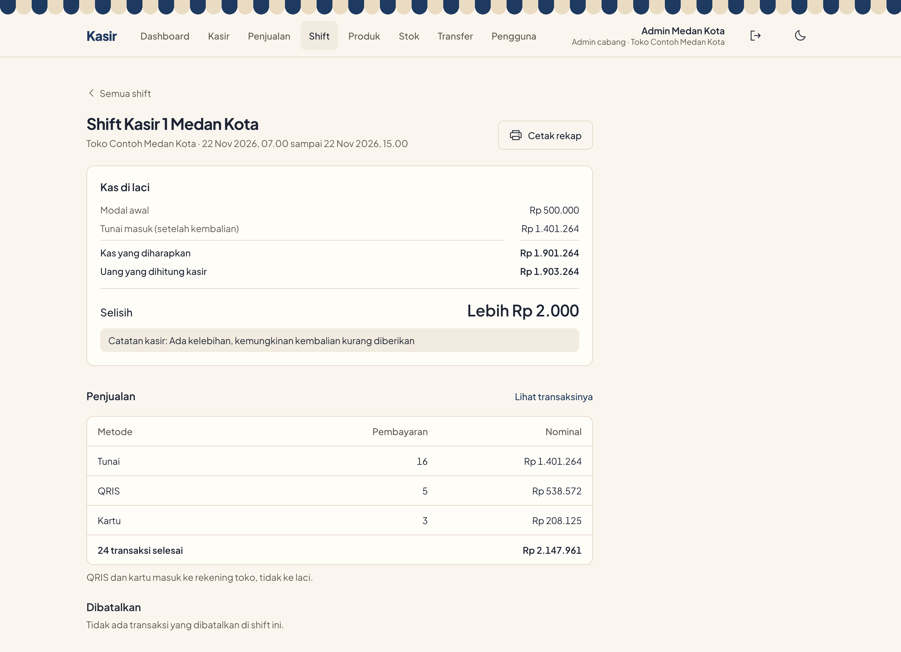
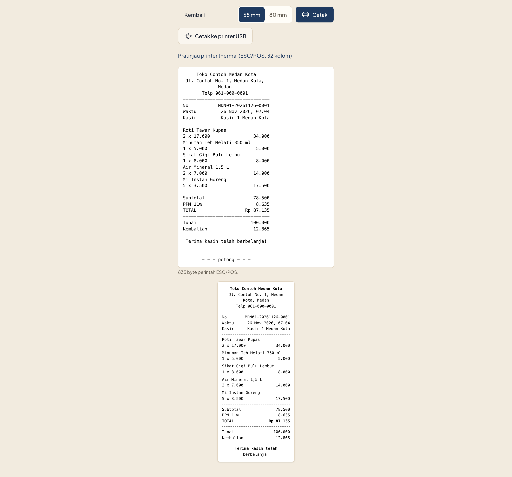
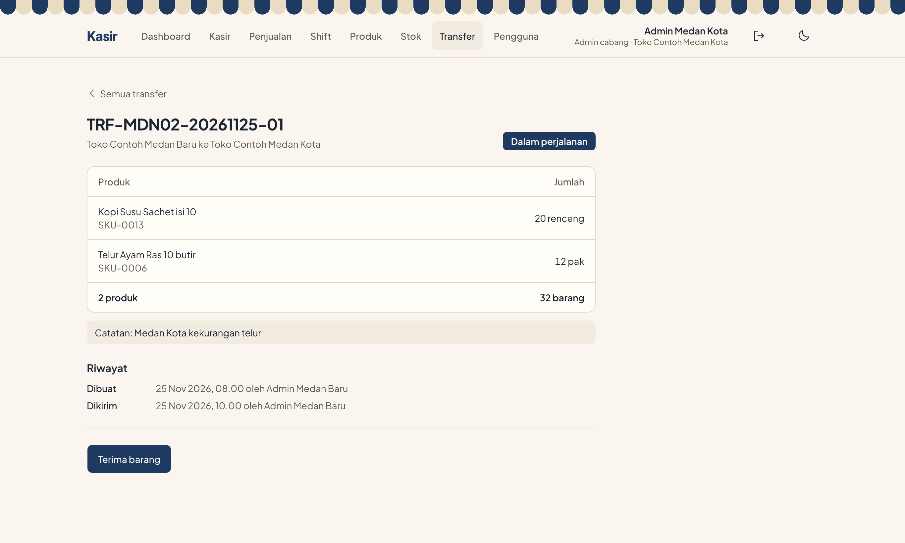
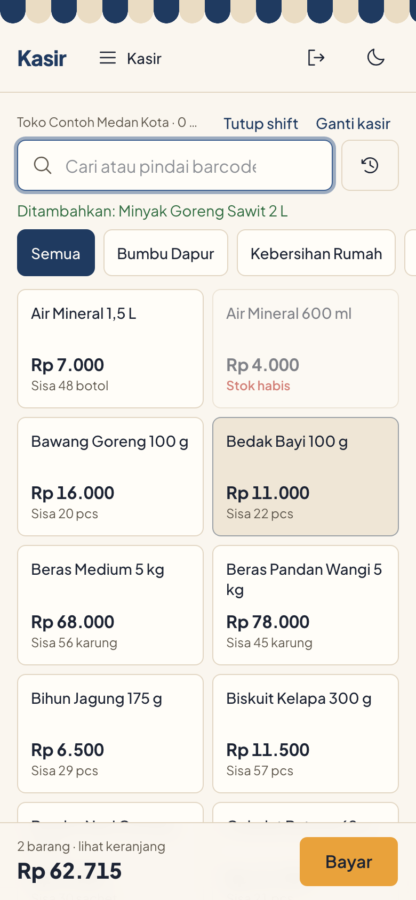
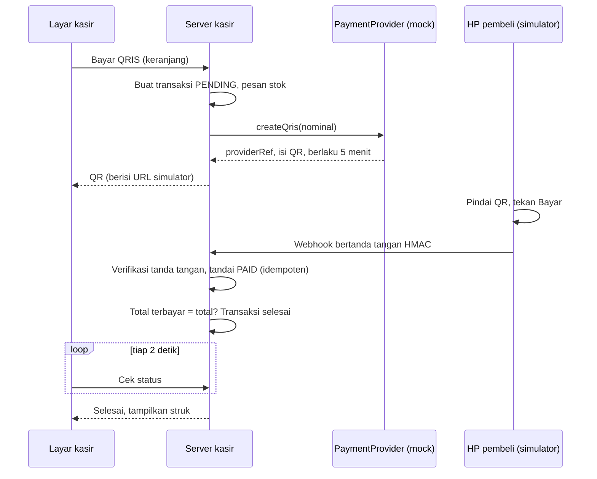

# Kasir

Aplikasi kasir (point of sale) multi-cabang untuk toko kelontong dan minimarket. Proyek portofolio.

> **Catatan:** semua toko, produk, akun, dan transaksi di aplikasi ini fiktif. Pembayaran QRIS dan kartu (EDC) adalah simulasi; tidak ada integrasi bank dan tidak ada uang yang berpindah.



## Yang bisa dilakukan

- **Layar kasir** untuk scanner barcode dan keyboard: tunai, QRIS dan kartu simulasi, kombinasi pembayaran, struk 58/80 mm lewat browser atau langsung ke printer thermal USB.
- **Shift kasir** dengan hitung buta saat tutup dan rekap selisih kas; **void** dengan alasan dan pengembalian stok.
- **Laporan**: dashboard harian dan 30 hari, riwayat penjualan dengan unduhan CSV, rekap shift.
- **Multi-cabang**: stok dan harga per cabang, transfer stok antar-cabang, perbandingan cabang untuk pemilik.
- **Hak akses per role** (Pemilik, Admin cabang, Kasir) yang dicek di server, dan ganti kasir dengan PIN di perangkat yang sama.
- **Bisa dipasang** ke layar utama tablet/HP (PWA).

| | |
|---|---|
|  |  |
| QRIS: QR dipindai HP pembeli ke halaman simulator | Dashboard: hari ini dibanding kemarin, per jam, 30 hari |
|  |  |
| Rekap shift: kas yang diharapkan vs dihitung | Struk browser dan pratinjau printer thermal |
|  |  |
| Transfer stok: dikirim, menunggu diterima | Layar kasir di HP |

## Status

| Fase | Isi | Status |
|---|---|---|
| 1. Fondasi | Next.js, Prisma 7 + PostgreSQL, login dan role, data contoh | Selesai |
| 2. Master data | Produk, kategori, stok per cabang, pengguna | Selesai |
| 3. Kasir + tunai + struk | Layar kasir, shift, pembayaran tunai, struk 58/80mm | Selesai |
| 4. Pembayaran simulasi | QRIS dan kartu tiruan, webhook HMAC, split payment | Selesai |
| 5. Shift dan laporan | Tutup shift, void, riwayat penjualan, dashboard dan grafik | Selesai |
| 6. Multi-cabang dan rilis | Transfer stok, kelola cabang, printer ESC/POS, ganti kasir dengan PIN, PWA, reset demo terjadwal | Selesai, deploy ditunda |

## Stack

- **Next.js 16** (App Router, Cache Components) + TypeScript
- **PostgreSQL** + **Prisma 7** (driver adapter `@prisma/adapter-pg`)
- **iron-session** untuk session cookie terenkripsi, **bcrypt** untuk kata sandi
- **Tailwind CSS 4** + **shadcn/ui** (Base UI), ikon **Phosphor**
- **Zod** untuk validasi input
- **Vitest** (logika bisnis dan integrasi database) dan **Playwright** (alur di browser)
- **Web Serial** untuk printer thermal USB, **service worker** sederhana untuk PWA

## Menjalankan di komputer sendiri

Butuh Node.js 22+, pnpm 10+, dan Docker.

```bash
pnpm install
cp .env.example .env          # lalu isi AUTH_SECRET dan MOCK_WEBHOOK_SECRET (openssl rand -base64 32)
pnpm db:up                    # PostgreSQL di Docker, port 5433
pnpm db:migrate               # buat tabel
pnpm db:seed                  # data contoh: 2 cabang, 54 produk, 30 hari transaksi
pnpm dev                      # http://localhost:3000 (port lain: pnpm dev -p 3001)
```

Perintah lain:

| Perintah | Fungsi |
|---|---|
| `pnpm test` | Unit test (harga, validasi, hak akses, tanda tangan webhook, keranjang) |
| `pnpm test:integration` | Test alur transaksi dengan database sungguhan (database terpisah `kasir_pos_test`, dibuat otomatis) |
| `pnpm test:e2e` | Test browser dengan Playwright (butuh database yang sudah di-seed) |
| `pnpm typecheck` | Pemeriksaan TypeScript |
| `pnpm db:reset` | Hapus database, migrasi ulang, dan seed ulang |
| `pnpm studio` | Prisma Studio untuk melihat isi database |

## Akun demo

Kata sandi semua akun: `demo12345`

| Role | Email | Cabang |
|---|---|---|
| Pemilik | `pemilik@demo.test` | Semua cabang |
| Admin cabang | `admin.mdn01@demo.test` | Medan Kota (MDN01) |
| Admin cabang | `admin.mdn02@demo.test` | Medan Baru (MDN02) |
| Kasir | `kasir1.mdn01@demo.test`, `kasir2.mdn01@demo.test` | Medan Kota |
| Kasir | `kasir1.mdn02@demo.test`, `kasir2.mdn02@demo.test` | Medan Baru |

**Ganti kasir dengan PIN:** di layar kasir, tekan "Ganti kasir", pilih nama, lalu ketik PIN (`1111` untuk kasir 1, `2222` untuk kasir 2). Admin cabang belum punya PIN; bisa diatur di halaman Pengguna.

## Keputusan teknis

- **Uang selalu integer Rupiah.** Tidak ada float untuk nominal. Rumus total ada di satu modul murni, [`lib/pricing.ts`](lib/pricing.ts), dan dipakai oleh checkout maupun seed.
- **Server menghitung ulang semua angka.** Klien hanya mengirim produk, jumlah, dan diskon.
- **Hak akses per role.** Katalog (produk & kategori) berlaku untuk semua cabang, jadi hanya Pemilik yang mengubahnya. Admin mengatur stok, stok minimum, harga khusus cabang, dan akun kasir di cabangnya sendiri. Kasir hanya memakai layar kasir.
- **Otorisasi di server.** [`proxy.ts`](proxy.ts) hanya mengarahkan pengunjung dengan cepat; hak akses yang sebenarnya dicek ulang ke database di [`lib/auth.ts`](lib/auth.ts) pada setiap halaman dan aksi. Admin dan kasir dibatasi ke cabangnya sendiri lewat [`lib/permissions.ts`](lib/permissions.ts).
- **Checkout atomik.** [`lib/checkout.ts`](lib/checkout.ts) membuat transaksi, item, pembayaran, nomor invoice, dan pengurangan stok dalam satu transaksi database. Bila stok habis di tengah jalan, semuanya batal.
- **Harga berubah di tengah transaksi tidak tertagih diam-diam.** Klien mengirim total yang dilihat kasir; bila berbeda dengan hitungan server (mis. admin baru saja mengubah harga), transaksi ditolak dan total baru ditampilkan.
- **Snapshot di transaksi.** Nama produk, harga, modal, dan tarif pajak disimpan di transaksi, jadi struk lama tetap benar walau produk atau tarif diubah.
- **Nomor invoice** berformat `MDN01-20261125-0001`, urut per cabang per hari. Tabel `InvoiceCounter` dinaikkan dengan `INSERT ... ON CONFLICT ... RETURNING` di dalam transaksi checkout; uji 15 checkout serentak menghasilkan 15 nomor unik tanpa lompatan.
- **Satu shift terbuka per kasir**, dijaga dengan advisory lock PostgreSQL supaya klik ganda tidak membuka dua shift.
- **Audit stok.** Setiap perubahan stok (barang masuk, penjualan, stok opname) dicatat di `StockMovement`; jumlah semua pergerakan selalu sama dengan stok di `BranchStock`.
- **Stok tidak bisa minus, termasuk saat ramai.** Pengurangan stok di [`lib/stock.ts`](lib/stock.ts) memeriksa sisa stok di dalam satu perintah `UPDATE`, sehingga dua kasir yang menjual barang terakhir bersamaan tidak bisa sama-sama berhasil. Stok opname mengunci baris (`SELECT ... FOR UPDATE`) supaya selisih yang dicatat tepat.
- **Akun dinonaktifkan langsung keluar.** Session dicek ulang ke database setiap request, jadi akun yang dinonaktifkan kehilangan akses tanpa menunggu cookie kedaluwarsa.
- **Barcode contoh** memakai awalan GS1 `20` (khusus pemakaian internal toko) dengan digit cek EAN-13 yang valid, sehingga tidak bertabrakan dengan produk asli.

## Layar kasir

- Kolom cari selalu fokus. Scanner barcode USB (yang mengetik kode lalu Enter) langsung menambahkan barang.
- Shortcut: `F2` cari, `F4` bayar, `+` / `-` ubah jumlah barang terakhir, `Esc` dua kali batalkan transaksi.
- Pembayaran tunai dengan tombol Uang pas dan saran nominal (50.000, 100.000, atau pembulatan ke atas).
- QRIS dan kartu (EDC) simulasi, dan kombinasinya (mis. sebagian QRIS, sisanya tunai).
- Struk 58 mm atau 80 mm (disimpan per perangkat), dicetak lewat dialog cetak browser, jadi bisa diuji tanpa printer dengan "Simpan sebagai PDF".
- Cetak ulang struk dari riwayat transaksi shift.
- Tutup shift dan ganti kasir dari tautan di atas kolom cari.

Arah desain dan alasan setiap pilihan visual ada di [`DESIGN.md`](DESIGN.md).

## Shift, void, dan laporan

- **Tutup shift dengan hitung buta.** Kasir mengisi jumlah uang di laci (langsung, atau per pecahan 100.000 sampai koin) tanpa melihat angka sistem. Kas yang diharapkan dan selisihnya baru tampil di rekap setelah shift ditutup, supaya hitungan kasir jujur. Rekap bisa dicetak untuk serah terima.
- **Kas yang diharapkan** = modal awal + semua pembayaran tunai yang masuk di shift itu (sudah dikurangi kembalian). QRIS dan kartu masuk ke rekening, jadi tidak dihitung. Angkanya disimpan saat tutup, sehingga void sesudahnya tidak mengubah rekap; void seperti itu ditandai terpisah.
- **Tutup shift ditolak bila masih ada transaksi menunggu pembayaran**, karena transaksi itu masih memegang stok. Baris shift dikunci saat tutup dan checkout memegang kunci bersama, jadi tidak ada transaksi yang masuk ke shift yang baru ditutup.
- **Void** hanya untuk Admin (cabangnya sendiri) dan Pemilik, wajib alasan, dan hanya untuk transaksi di shift yang masih buka atau yang dibuat hari ini. Stok kembali lewat `VOID_RETURN`, pembayaran ditandai `REFUNDED`, dan QRIS/kartu dikembalikan lewat `PaymentProvider.refund` (idempoten). Layar memberi tahu berapa uang tunai yang harus dikembalikan ke pembeli. Transaksi yang macet setengah lunas juga bisa di-void admin.
- **Riwayat penjualan** (`/sales`) dengan saringan tanggal, kasir, metode, status, dan nomor invoice, plus unduhan CSV dengan saringan yang sama. CSV memakai pemisah titik koma karena Excel berbahasa Indonesia memakai `;` sebagai pemisah daftar, dan teks yang bisa terbaca sebagai rumus dinetralkan.
- **Dashboard**: omzet hari ini dibanding kemarin sampai jam yang sama, jumlah transaksi, rata-rata belanja, laba kotor (penjualan bersih sebelum pajak dikurangi modal), omzet per jam dengan garis rata-rata 28 hari sebelumnya, omzet 30 hari, produk terlaris, dan stok menipis. Pemilik bisa memilih satu cabang atau semua cabang beserta tabel perbandingan.
- **Angka laporan dihitung di database.** Agregasi memakai SQL dengan jam WIB (`at time zone 'Asia/Jakarta'`), tanpa query per cabang atau per produk. Integration test mencocokkan angka dashboard dengan hitungan manual per transaksi.
- **Grafik tanpa library chart.** Komponen [`ColumnChart`](components/charts/column-chart.tsx) dirender sebagai HTML biasa: tooltip lewat hover maupun panah keyboard, diumumkan ke pembaca layar, dan setiap grafik punya tampilan tabel.

## Multi-cabang

- **Transfer stok** (`/transfers`): cabang asal membuat draf, lalu mengirim; saat itu stok asal berkurang (`TRANSFER_OUT`) dan barang dianggap dalam perjalanan. Cabang tujuan menekan "Terima barang", stok tujuan bertambah (`TRANSFER_IN`). Satu produk yang kurang stok membatalkan seluruh pengiriman. Admin hanya bertindak atas nama cabangnya; baris transfer dikunci sehingga kirim ganda hanya berefek sekali.
- **Kelola cabang** (`/branches`, Pemilik): alamat, telepon, tarif PPN, catatan kaki struk. Cabang baru langsung punya stok 0 untuk semua produk. Cabang yang masih punya shift buka atau transfer dalam perjalanan tidak bisa dinonaktifkan.
- **Perbandingan cabang** di dashboard pemilik: omzet hari ini dan 30 hari, laba kotor, transaksi, rata-rata belanja, stok menipis.
- **Audit stok**: integration test memastikan jumlah semua pergerakan stok (`StockMovement`) sama dengan stok di setiap cabang, termasuk setelah penjualan, void, opname, dan transfer.

## Ganti kasir dengan PIN

Perangkat kasir login sekali dengan email. Setelah itu kasir bergantian dengan memilih nama dan mengetik PIN 4 sampai 6 angka; hanya akun di cabang yang sama yang bisa dipilih.

- **Batas tebakan:** 5 kali salah berturut-turut mengunci PIN akun itu selama 5 menit. Baris user dikunci saat memeriksa PIN, jadi tebakan paralel tetap dihitung satu per satu (diuji dengan 10 tebakan serentak).
- Ganti kasir ditolak selama keranjang berisi atau ada transaksi menunggu pembayaran. Shift kasir sebelumnya tetap terbuka; dialog mengingatkan untuk menutupnya bila laci diserahkan.

## Printer struk thermal (ESC/POS)

- Cetak lewat dialog browser tetap jalur utama (bisa diuji dengan "Simpan sebagai PDF").
- [`lib/escpos.ts`](lib/escpos.ts) membangun perintah ESC/POS (32 kolom untuk 58 mm, 48 kolom untuk 80 mm) dari data struk yang sama, beserta pratinjau teks di halaman struk supaya bisa diperiksa tanpa printer.
- Tombol "Cetak ke printer USB" memakai **Web Serial** dan hanya muncul di browser yang mendukungnya (Chrome/Edge desktop). Test e2e memakai port serial tiruan untuk memeriksa byte yang terkirim.

## PWA dan koneksi terputus

- Bisa dipasang ke layar utama (manifest, ikon, service worker).
- Service worker hanya menyimpan aset statis dan halaman `/offline`. Halaman dan data selalu diambil dari server.
- **Sengaja tidak ada mode offline untuk transaksi.** Checkout tidak idempoten; mengantrekan dan mengulangnya otomatis setelah online bisa mencatat transaksi dua kali dan menjual stok yang sudah habis di kasir lain. Karena itu `experimental.useOffline` dari Next juga tidak dipakai. Saat offline, aplikasi menampilkan banner yang jelas.

## Data demo

- `pnpm db:seed` membuat 2 cabang, 54 produk, sekitar 2.700 transaksi 30 hari terakhir (termasuk hari ini sampai jam seed dijalankan), shift dengan sesekali selisih kas, dan 3 contoh transfer. Stok awal dihitung mundur supaya riwayat stok selalu cocok.
- **Reset terjadwal:** `GET /api/cron/reset-demo` dijadwalkan Vercel Cron setiap hari 03.00 WIB ([`vercel.json`](vercel.json)), supaya demo publik selalu rapi dan dashboard "hari ini" terisi. Route ini menghapus semua data, jadi punya dua pengaman: hanya aktif bila `DEMO_RESET_ENABLED=true`, dan harus membawa `CRON_SECRET`.

## Arsitektur pembayaran

Semua pembayaran non-tunai lewat satu interface, [`PaymentProvider`](lib/payments/provider.ts). Saat ini implementasinya [`MockProvider`](lib/payments/mock.ts) yang meniru perilaku gateway sungguhan; menambah Midtrans atau Xendit cukup dengan implementasi baru dan variabel `PAYMENT_PROVIDER`, tanpa mengubah layar kasir.



- **QRIS:** QR berisi URL [halaman simulator](app/simulator/pay/[ref]/page.tsx), jadi bisa dipindai kamera HP saat demo. Halaman itu berlabel jelas sebagai demo. Di laptop, tombol "Buka simulator" membuka halaman yang sama.
- **Webhook:** body ditandatangani HMAC-SHA256 bersama timestamp (`MOCK_WEBHOOK_SECRET`), ditolak bila tanda tangan salah atau umurnya lebih dari 5 menit. Webhook yang sama dikirim dua kali hanya berefek sekali.
- **Kartu (EDC):** terminal "berpikir" 2 sampai 4 detik. Aturan uji ala sandbox: **nominal yang berakhiran 13 selalu ditolak**, selain itu disetujui dengan 4 digit kartu dan kode approval acak.
- **Kombinasi:** QRIS dan kartu bisa untuk sebagian tagihan; tunai selalu menjadi pelunasan terakhir. Transaksi selesai saat jumlah pembayaran yang masuk sama dengan total.
- **Stok dipesan saat menunggu.** Begitu transaksi QRIS/kartu dibuat, stoknya langsung berkurang supaya tidak terjual dua kali di kasir lain, dan dikembalikan bila transaksi dibatalkan sebelum ada uang masuk. Transaksi yang sudah dibayar sebagian tidak bisa dibatalkan kasir.
- **Tahan reload.** Transaksi yang menunggu pembayaran tersimpan di server; bila halaman kasir dimuat ulang, transaksi itu dilanjutkan.

## Pengujian

| Jenis | Isi |
|---|---|
| Unit (`pnpm test`) | Rumus harga dan pajak, validasi, hak akses, keranjang, tanda tangan webhook, aturan void dan PIN, kas laci, skala grafik, CSV, builder ESC/POS |
| Integrasi (`pnpm test:integration`) | Database sungguhan: stok tidak minus saat 20 pengurangan serentak, nomor invoice unik saat 15 checkout serentak, QRIS/kartu/kombinasi, tutup shift bersamaan dengan checkout, void ganda, transfer, tebakan PIN serentak, angka dashboard, audit stok |
| E2E (`pnpm test:e2e`) | Alur di browser untuk setiap role: kasir dengan keyboard, QRIS lewat simulator, tutup shift, void, transfer, ganti kasir, printer USB tiruan, PWA offline |

## Deploy (belum dilakukan)

Target: Vercel + Neon (PostgreSQL). Langkah singkat bila nanti dideploy:

1. Buat database di Neon, salin connection string ke `DATABASE_URL`.
2. Buat project Vercel dari repo ini, isi env: `DATABASE_URL`, `AUTH_SECRET`, `MOCK_WEBHOOK_SECRET`, `NEXT_PUBLIC_APP_URL`, dan untuk demo publik `DEMO_RESET_ENABLED=true` serta `CRON_SECRET`.
3. Jalankan migrasi dan seed sekali ke database Neon: `pnpm db:deploy && pnpm db:seed` (dengan `DATABASE_URL` Neon).
4. Deploy. Vercel membaca jadwal cron dari `vercel.json`.
